<p align="center">
  
</p>

<p align="center">
  
  
  
  
  
  
  
  
</p>

<p align="center">
  <b>Minor Project · B.Tech CSE (AI/ML) · Roorkee Institute of Technology</b><br>
  Ayush Singh · Roll No. 230240170024
</p>

<p align="center">
  <a href="#quick-start">Quick start</a> ·
  <a href="#website">Website</a> ·
  <a href="#voice">Voice</a> ·
  <a href="#architecture">Architecture</a> ·
  <a href="#route-api">Route API</a> ·
  <a href="#ai-stack">AI stack</a> ·
  <a href="#evaluation">Evaluation</a> ·
  <a href="#structure">Structure</a>
</p>

---

**YatraSetu** (*setu* = bridge) connects Char Dham and Hemkund Sahib pilgrims with verified, personalised safety
information in their own language, by text or by voice. District officials get one place to publish advisories
and reach the travellers on an affected route.

<p align="center">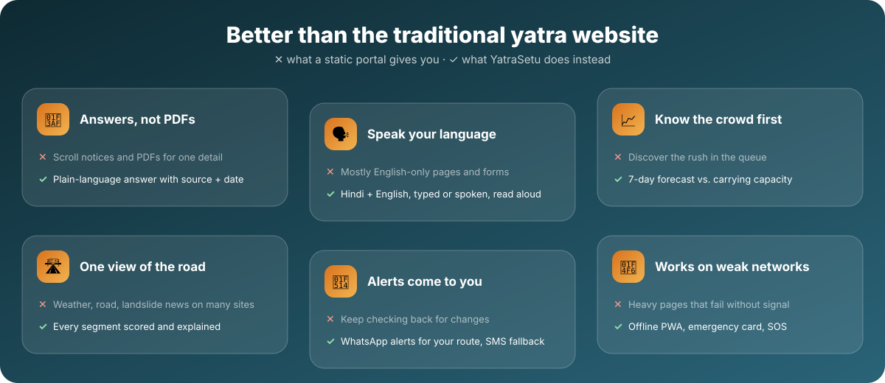</p>

## ✨ Features

| | Module | What it does | AI / technique |
|---|---|---|---|
| 💬 | **Multilingual assistant** | Answers yatra questions in English and Hindi (more via Bhashini), with sources and dates, follow-up suggestions and one-tap actions | Script-based language detection, TF-IDF + logistic-regression intent model, hybrid TF-IDF retrieval (RAG), OpenRouter LLM through LangChain with a numeric-grounding guardrail |
| 🎙️ | **Voice commands** | Speak a question or a command ("open crowd forecast for Badrinath", "भीड़ दिखाओ"). Answers can be read aloud | Browser Web Speech API (SpeechRecognition + SpeechSynthesis), English/Hindi command grammar |
| 📊 | **Crowd forecast** | 7-day footfall forecast per shrine against carrying capacity, lighter dates and alternatives | Histogram gradient-boosting regressor on calendar + weather features |
| 🛣️ | **Route risk** | Clickable risk map with a score breakdown per segment, live closures / IMD alerts / advisories, a timed trip planner with overnight halts, "near me" and a shrine-route comparison | Transparent weighted risk score (IMD alert, rain, road status, terrain) + rule-based itinerary planning |
| ❤️ | **Health check** | Readiness category, screening points and medical posts on the route | Rule-based triage (no diagnosis) |
| 🔔 | **Trip alerts & SOS** | Consent-based trip subscription, WhatsApp alerts with SMS fallback, SOS with nearest help and "locate me" | Haversine nearest-facility search |
| 🏛️ | **Officials' dashboard** | Advisory drafting and four-eyes approval, road status, IMD alerts, delivery log, model metrics, audit log | Role-based access control |

<a id="quick-start"></a>

## 🚀 Quick start

```bash
cd YatraSetu-AI
cp .env.example .env          # optional: add OPENROUTER_API_KEY for generative answers
./run.sh
```

Then open **<http://127.0.0.1:8000>** (traveller website) and **<http://127.0.0.1:8000/admin>** (officials' dashboard).
Demo logins: `editor / editor123` (drafts advisories) and `approver / approver123` (publishes them).

<details>
<summary><b>Manual setup</b></summary>

```bash
python3 -m venv .venv && source .venv/bin/activate
pip install -r requirements.txt
cp .env.example .env                 # optional AI provider config
python scripts/generate_data.py      # synthetic footfall history (already included)
python scripts/seed_demo.py          # demo weather alerts, road status, subscriptions
uvicorn app.main:app --reload
```
</details>

<a id="website"></a>

## 🌄 The website

A single-page traveller site with a sticky navbar, hash routing (every view has a shareable link such as
`/#crowd?shrine=badrinath`), smooth page transitions, scroll-reveal animations and photo backgrounds of
Uttarakhand's temples and mountains.

| Home: hero, ask box and floating highlights | Assistant: voice, actions, live mini-forecast |
|---|---|
| 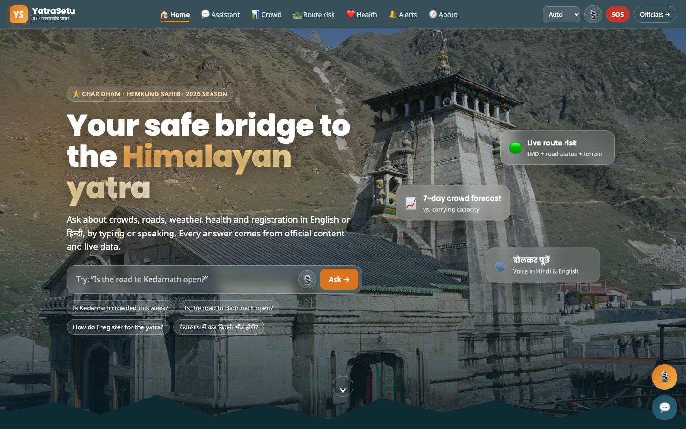 | 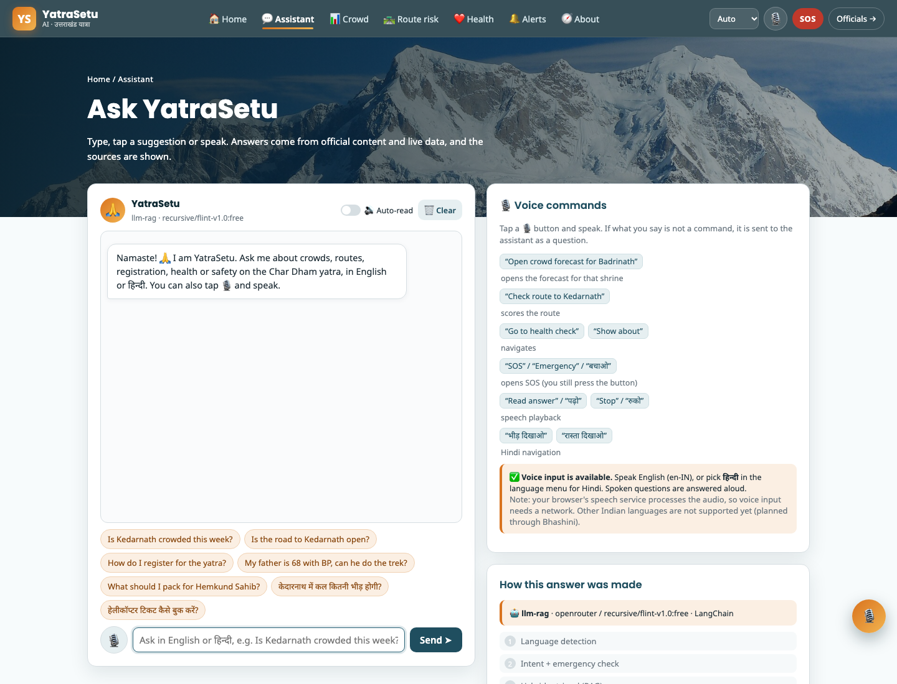 |
| **Crowd forecast**: shrine pills, 7-day cards, capacity line | **Route risk**: live KPIs, clickable map, trip planner, alerts, route comparison |
| 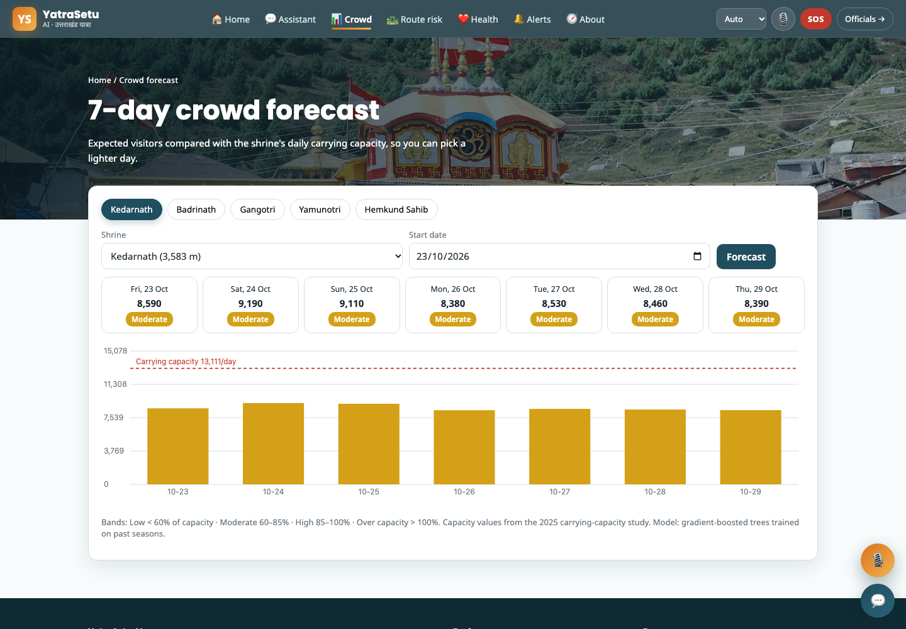 | 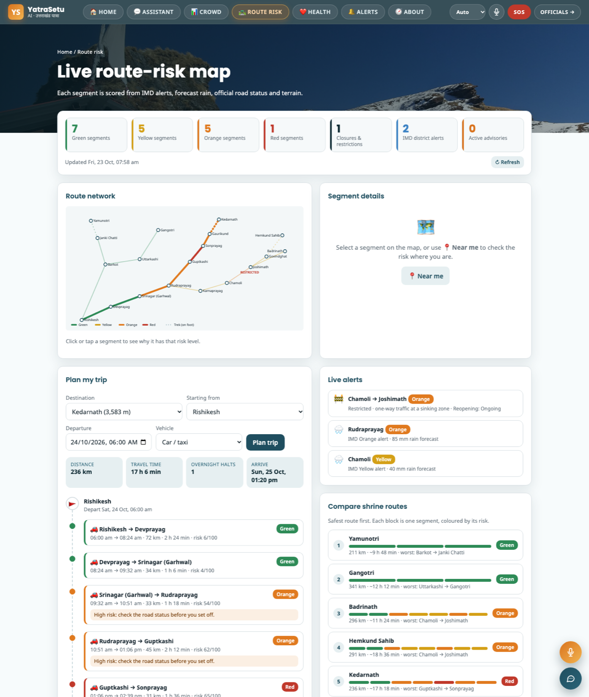 |

<details>
<summary><b>🧭 About page: interactive architecture, pipeline and repository map</b></summary>
<br>
<p align="center">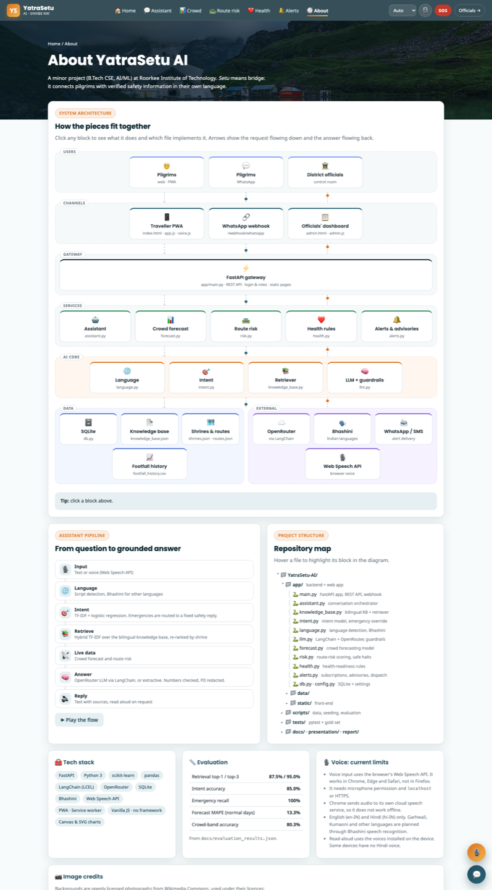</p>

Click any block in the architecture diagram to see what it does and which file implements it, press
**▶ Play the flow** to animate the assistant pipeline, and hover a file in the repository map to highlight its block.
</details>

**Navigation at a glance**

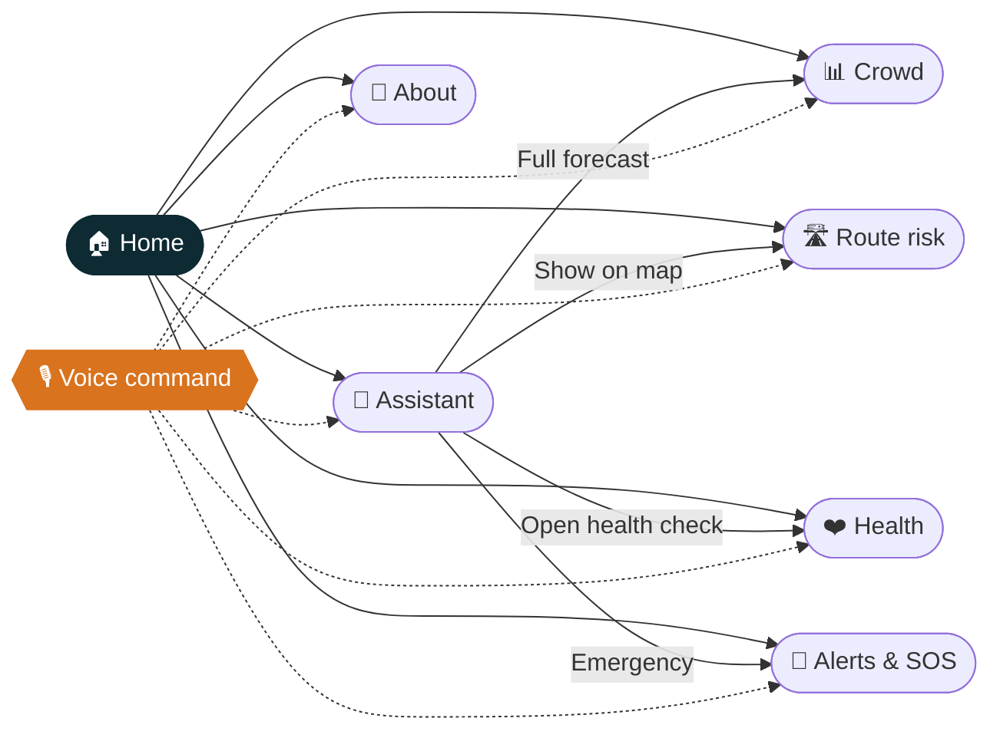

**What makes it easy to use**

- 🔎 Ask from the hero box on the home page, from the floating 💬 button on any page, or press <kbd>/</kbd>.
- 🧩 Every answer has **🔊 Listen**, **📋 Copy**, follow-up question chips and action buttons ("Full forecast for Kedarnath", "Show on route map", "Open SOS").
- 📈 Crowd answers include an inline 7-day mini chart; the side panel ticks off which pipeline steps were used.
- 💾 The conversation is kept in the browser between visits (cleared with 🗑️ Clear).
- 🗺️ Live shrine cards on the home page show today's crowd band and route risk for all five shrines.
- 📱 Responsive down to phone width, with a hamburger menu, large tap targets and `prefers-reduced-motion` support.

<a id="voice"></a>

## 🎙️ Voice commands

Tap any 🎙️ button (navbar, hero, chat bar or floating button) and speak. If what you say is not a command, it is
sent to the assistant as a question and the answer is read back to you.

| Say | What happens |
|---|---|
| "Open crowd forecast for Badrinath" | Opens the crowd page with Badrinath selected |
| "Check route to Kedarnath" | Opens the route page and scores the Kedarnath route |
| "Go to health check", "Show about" | Navigates |
| "भीड़ दिखाओ", "रास्ता दिखाओ" | Hindi navigation |
| "SOS", "Emergency", "बचाओ" | Opens and highlights SOS (you still press the button) |
| "Read answer" / "पढ़ो", "Stop" / "रुको" | Read-aloud control |
| "Clear chat" | Clears the conversation |
| *anything else* | Asked to the assistant, answer spoken aloud |

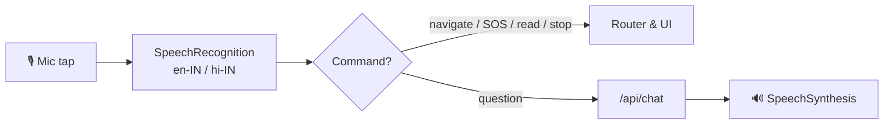

> [!NOTE]
> **Current voice limits.** Voice input uses the browser's Web Speech API, so it is not done on the server:
> - It works in **Chrome, Edge and Safari**, not in Firefox or some embedded browsers. The app detects this and shows a note instead of a broken button.
> - It needs microphone permission and a secure page (`localhost` or HTTPS).
> - Chrome sends the audio to its cloud speech service, so voice input needs a network and is not fully private or offline.
> - **English (en-IN) and Hindi (hi-IN)** only. In *Auto* mode it listens in English; pick हिन्दी in the navbar to speak Hindi. Garhwali, Kumaoni and other Indian languages are planned through Bhashini speech recognition (ASR).
> - Read-aloud uses the voices installed on the device, and some devices have no Hindi voice.

<a id="architecture"></a>

## 🏗️ Architecture

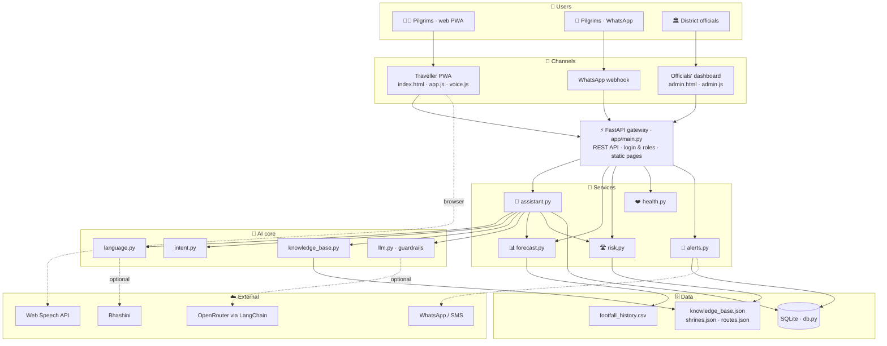

<details>
<summary><b>Request flow for one chat message</b></summary>

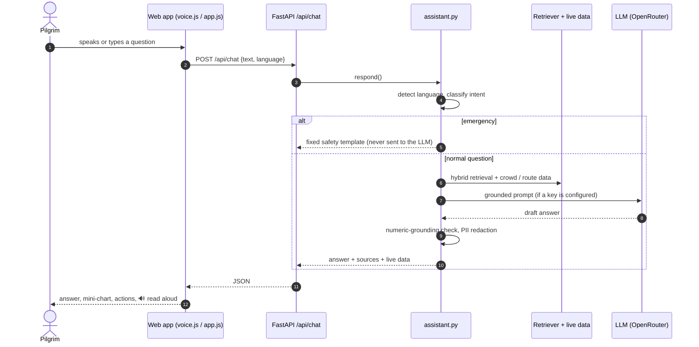
</details>

<a id="route-api"></a>

## 🛣️ Route-risk API

The route page is backed by these endpoints (all `GET`, JSON). Interactive docs are at `/docs` when the server is running.

| Endpoint | Returns |
|---|---|
| `/api/risk/network` | Every segment with score, level, reasons (English + Hindi), score split by factor, road status |
| `/api/risk/summary` | Segments by level, closures and restrictions, active IMD district alerts, advisory count |
| `/api/risk/segment/{id}` | One segment: score breakdown, weather, road status, advisories, facilities at both ends, safe halt |
| `/api/risk/advisories` | Published advisories that are still valid, with readable segment names |
| `/api/risk/compare` | All five shrine routes side by side, safest first |
| `/api/risk/trip/{shrine}` | Risk for every segment on a shrine's route and the worst stretch |
| `/api/risk/plan/{shrine}?start=&depart=&vehicle=` | Timed itinerary: per-leg ETA and risk, overnight halts, stop before a closed road |
| `/api/risk/nearby?lat=&lon=` | Nearest point on the network, the risk around it and the nearest medical help |

```bash
curl "http://127.0.0.1:8000/api/risk/plan/kedarnath?start=guptkashi&depart=2026-05-20T06:00&vehicle=bus"
```

<details>
<summary><b>How the trip planner decides</b></summary>

- **Speeds** (planning values): hill roads 24–35 km/h by slope class, treks 2.3–3.2 km/h (Gaurikund → Kedarnath ≈ 7 h).
  Buses take 20% longer; restricted roads add 30% and an Orange/Red IMD alert adds 20%.
- **Night rule:** no hill-road leg may start or end between 22:00 and 04:00, and treks must start by 14:00.
  Otherwise the plan adds an overnight halt and resumes at 05:00, warning if that town has no listed stay.
- **Closed road:** the plan stops at the nearest earlier town with stay and medical facilities and shows the expected reopening.
- Conditions are those *now*. The planner says so and asks travellers to re-check before leaving.
</details>

<a id="ai-stack"></a>

## 🤖 AI stack: OpenRouter + LangChain

The generative layer is a LangChain **LCEL** chain:

```
ChatPromptTemplate  →  ChatOpenAI(OpenRouter)  →  StrOutputParser
```

Set `OPENROUTER_API_KEY` in `.env` (get one at <https://openrouter.ai/keys>) and optionally
`OPENROUTER_MODEL` (default `openai/gpt-4o-mini`). OpenRouter's attribution headers
(`HTTP-Referer`, `X-Title`) and a fallback-model list are supported.

Safety and cost controls sit both before and after the model:

* 🚨 emergencies are answered by a deterministic template and **never** call the LLM;
* 📚 retrieval only sends approved knowledge-base passages and live service data;
* 🔢 every number in the generated answer must appear in those passages, otherwise the
  answer is rejected and the extractive response is shown;
* 🔒 phone numbers and e-mails are redacted before text leaves the system;
* ⚡ responses are cached in-process, and the chain falls back to offline mode on
  timeout, auth or quota errors.

Without a key the app still runs end to end using extractive answers. The current mode is
shown in the assistant header and at `GET /api/ai/status`.

<a id="evaluation"></a>

## 📏 Evaluation

```bash
pytest -v                            # 28 unit and API tests
python scripts/evaluate.py           # retrieval, intent, emergency and forecast metrics
```

| Metric | Result | |
|---|---|---|
| Retrieval top-1 / top-3 accuracy (40 bilingual questions) | 87.5% / 95.0% | `███████████████████░` |
| Intent accuracy (unseen questions) | 85.0% | `█████████████████░░░` |
| Emergency recall | **100%** | `████████████████████` |
| Off-topic rejection | 80% | `████████████████░░░░` |
| Forecast MAPE, normal days (held-out 2025 season) | 13.3% | lower is better |
| Crowd-band accuracy | 80.3% | `████████████████░░░░` |

Full numbers: [`docs/evaluation_results.json`](docs/evaluation_results.json).

<a id="structure"></a>

## 🗂️ Project structure

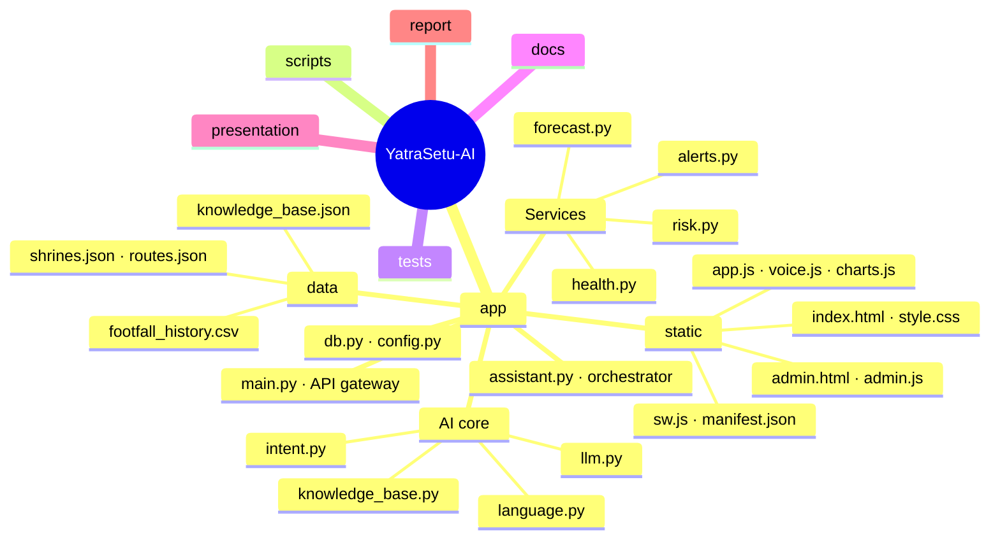

<details>
<summary><b>Plain-text tree</b></summary>

```
app/
  main.py            FastAPI app: REST API, WhatsApp webhook, static pages
  assistant.py       conversation orchestrator (language -> intent -> retrieval -> live data -> answer)
  knowledge_base.py  bilingual knowledge base + hybrid TF-IDF retriever
  intent.py          intent classifier, emergency override, entity extraction
  language.py        language detection + Bhashini client
  llm.py             LangChain + OpenRouter chain, grounding guardrail and PII redaction
  forecast.py        crowd forecasting model and evaluation
  risk.py            route-risk scoring, live feed, trip planner, safe-halt and nearby search
  health.py          health-readiness rules
  alerts.py          subscriptions, advisories (four-eyes), alert dispatch with SMS fallback
  db.py, config.py   SQLite persistence and configuration
  data/              knowledge base, shrines, route network, footfall history
  static/            traveller website and officials' dashboard (HTML/CSS/JS, no framework)
    index.html         navbar, home, assistant, crowd, route, health, alerts, about
    app.js             hash router, home live status, assistant, tools, About interactions
    voice.js           voice commands (SpeechRecognition) and read-aloud (SpeechSynthesis)
    charts.js          dependency-free canvas charts and SVG route map
    sw.js              offline cache (network-first, cache fallback)
scripts/             data generation, demo seeding, evaluation, demo-deck build
tests/               pytest suite and bilingual gold question set
docs/                banner and graphics, screenshots, diagrams, evaluation results, demo runbook
presentation/        live-demo deck and project pitch
report/              project report (DOCX / PDF)
```
</details>

## 🎤 Demo materials

| File | What it is |
|---|---|
| `presentation/YatraSetu_AI_Demo.pptx` | 17-slide live-demo deck with speaker notes on every slide |
| `docs/DEMO_SCRIPT.md` | Pre-flight checklist, timed run sheet, exact demo inputs, fallback table and Q&A |
| `presentation/YatraSetu_AI_Pitch.pptx` | 15-slide project pitch for reviews and funding conversations |

Rebuild the demo deck with `python scripts/make_demo_deck.py`.

<details>
<summary><b>🔌 Optional integrations</b></summary>

Set these environment variables (or put them in `.env`) to switch on external services:

| Variable | Purpose |
|---|---|
| `OPENROUTER_API_KEY`, `OPENROUTER_MODEL` | OpenRouter model used through the LangChain chain (generative RAG answers) |
| `OPENROUTER_FALLBACK_MODELS` | Comma-separated OpenRouter fallback models |
| `LLM_API_URL`, `LLM_API_KEY`, `LLM_MODEL` | Any other OpenAI-compatible endpoint (used only when the OpenRouter key is empty) |
| `BHASHINI_API_KEY`, `BHASHINI_USER_ID` | Bhashini translation for Indian languages beyond English and Hindi |

Without them the app runs fully offline with extractive answers.
</details>

## 📝 Data notes

* Carrying-capacity values are from the 2025 study reported by ETV Bharat (May 2026).
* The daily footfall history is **synthetic**, calibrated to published season totals, because shrine-wise daily
  data needs a data-sharing agreement. Replace `app/data/footfall_history.csv` with official data to retrain.
* Knowledge-base content and route attributes are compiled for demonstration and must be verified against current
  official advisories before any real deployment.

## 📷 Image credits

Website backgrounds are openly licensed photographs from Wikimedia Commons, loaded from `upload.wikimedia.org`
and credited on the site's About page:
[Kedarnath Temple](https://commons.wikimedia.org/wiki/File:Kedarnath_Temple.jpg) (public domain) ·
[Badrinath Temple](https://commons.wikimedia.org/wiki/File:Badrinath_Temple,_Uttarakhand_(Photo-_Vishwanath_Negi).jpg) (Vishwanath Negi, CC BY 4.0) ·
[Gangotri Temple](https://commons.wikimedia.org/wiki/File:Gangotri_Temple_2.jpg) (Arupamdas, CC BY-SA 4.0) ·
[Yamunotri](https://commons.wikimedia.org/wiki/File:Yamunotri_temple_under_the_glacier.jpg) (Anurag.vq, CC BY-SA 4.0) ·
[Hemkund Sahib](https://commons.wikimedia.org/wiki/File:Hemkund_Sahib_and_Lokpal_Lake.jpg) (Harshit SR, CC BY-SA 4.0) ·
[Chaukhamba from Madhyamaheshwar](https://commons.wikimedia.org/wiki/File:Chaukhamba_from_Madhyamaheshwar.jpg) (Abhishek.ghosh1984, CC BY-SA 4.0) ·
[Chaukhamba](https://commons.wikimedia.org/wiki/File:Chaukhamba_Uttarakhand_India_November_2013.jpg) (Paul Hamilton, CC BY-SA 2.0) ·
[Chandrashila from Tungnath](https://commons.wikimedia.org/wiki/File:Chandrashila_peak_from_Tungnath_Temple.jpg) (Navdeep Gusain, CC BY-SA 4.0) ·
[Valley of Flowers](https://commons.wikimedia.org/wiki/File:Valley_of_flowers_national_park,_Uttarakhand,_India.jpg) (Rohit Sharma, CC BY-SA 4.0).
The banner and comparison graphics in `docs/` are original SVGs made for this project.

<p align="center"><sub>Made with 🙏 for safer yatras · Prototype with demo data · Verify with official sources</sub></p>
